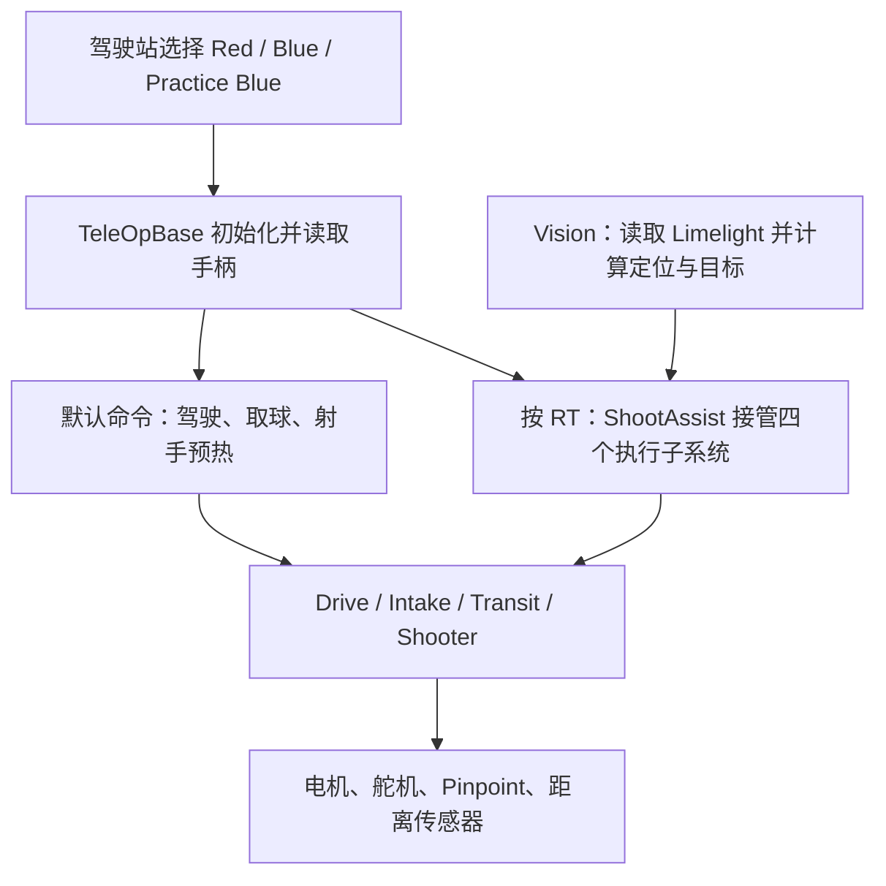

# 程序从哪里开始，各部分怎样配合

分析版本：`c600214842e1c2c4d3b75428453c4d8f3fb9f3e3`。这是源码结构说明，实车情况见[当前状态](STATUS.md)。

## 先记住三个词

- **OpMode**：驾驶站里选中的运行程序，例如 `Blue`。选错入口，按键含义可能不同。
- **子系统（Subsystem）**：管理一种机构或传感器，例如吸球、射手、视觉。
- **命令（Command）**：把几个动作组织起来。例如 RT 辅助射击要同时协调底盘、射手、吸球和输送。

RT 接管时，调度器会中断占用同一机构的默认命令；松开后再恢复默认命令。不能让两个新命令同时直接写同一电机而不说明谁有优先权。依据：[主入口初始化与按键绑定](https://github.com/pengjinDaniel/FTC-16095-FatDragon-2027-Public/blob/c600214842e1c2c4d3b75428453c4d8f3fb9f3e3/TeamCode/src/main/java/org/firstinspires/ftc/teamcode/opmodes/teleops/TeleOpBase.java#L48-L94)、[RT 的机构占用与结束处理](https://github.com/pengjinDaniel/FTC-16095-FatDragon-2027-Public/blob/c600214842e1c2c4d3b75428453c4d8f3fb9f3e3/TeamCode/src/main/java/org/firstinspires/ftc/teamcode/commands/ShootAssistCommand.java#L62-L117)。

## 找代码时，按问题找目录

| 你要查什么 | 阅读位置 | 这一层负责什么 |
|---|---|---|
| 选哪个红蓝入口、INIT/START/STOP 做什么 | `opmodes/teleops` | 联盟选择、生命周期、默认命令和诊断 |
| 手柄如何变成动作 | `commands` | 驾驶、取球、辅助射击与优先级 |
| 电机、舵机、传感器具体怎么控制 | `subsystems` | `drive`、`intake`、`transit`、`shooter`、`vision` |
| 七段自动路线 | `opmodes/autos/Test.java` | 路径、取球、三次射击的先后次序 |
| 路径跟踪和标定参数 | `pedro` | Mecanum、Pinpoint、Foresight 配置与调参入口 |
| 真实硬件调试入口 | `TeamCode/.../tests` | 瞄准、射手、Dashboard 调参；会控制硬件 |
| 不接车的检查 | 仓库根 `local-tests` | Java 检查和上传脚本的 Python 测试 |
| 生成安装包 | `TeamCode/build.gradle` | `TeamCode` 是应用模块，引用 `FtcRobotController` SDK 宿主模块 |

依据：[应用模块及依赖](https://github.com/pengjinDaniel/FTC-16095-FatDragon-2027-Public/blob/c600214842e1c2c4d3b75428453c4d8f3fb9f3e3/TeamCode/build.gradle#L1-L25)、[自动动作顺序](https://github.com/pengjinDaniel/FTC-16095-FatDragon-2027-Public/blob/c600214842e1c2c4d3b75428453c4d8f3fb9f3e3/TeamCode/src/main/java/org/firstinspires/ftc/teamcode/opmodes/autos/Test.java#L58-L69)、[路径跟踪配置](https://github.com/pengjinDaniel/FTC-16095-FatDragon-2027-Public/blob/c600214842e1c2c4d3b75428453c4d8f3fb9f3e3/TeamCode/src/main/java/org/firstinspires/ftc/teamcode/pedro/Constants.java#L22-L64)、[调参入口](https://github.com/pengjinDaniel/FTC-16095-FatDragon-2027-Public/blob/c600214842e1c2c4d3b75428453c4d8f3fb9f3e3/TeamCode/src/main/java/org/firstinspires/ftc/teamcode/pedro/Tuning.java#L13-L37)。

## 驾驶站里有哪些队伍入口

本版扫描到 9 个带 `@TeleOp` 或 `@Autonomous` 的队伍入口，没有 `@Disabled`；下面是源码中的显示名。驾驶站是否显示，仍取决于实际安装的 APK。

| 显示名 | 用来做什么 | 先注意什么 |
|---|---|---|
| `Red` / `Blue` | 主驾驶，按联盟选择 | RT 自动瞄准与距离射击；默认射手会预热 |
| `Practice Blue` | 蓝方手动瞄准练习 | 只取消自动转向；射击距离仍依赖视觉建立的定位 |
| `test`，分组 `Auto` | 当前唯一的自动入口 | Foresight 配置仍为空，当前默认代码会提示并退出 |
| `Limelight Aim Test Red` / `Limelight Aim Test Blue` | 仅测试底盘瞄准和视觉 | 不创建射手；不能拿它验证发射 |
| `Shooter PID` | 射手、送球和取球调试 | RB/LB 含义与主驾驶不同 |
| `Shooter Test` | 检查距离与转速、仰角的对应 | 底盘被停止，没有取球/送球控制 |
| `DashTuner` | 通过 Dashboard 单独调硬件 | 属于直接硬件控制，没有主驾驶的 B 停止逻辑 |

入口依据：[Red](https://github.com/pengjinDaniel/FTC-16095-FatDragon-2027-Public/blob/c600214842e1c2c4d3b75428453c4d8f3fb9f3e3/TeamCode/src/main/java/org/firstinspires/ftc/teamcode/opmodes/teleops/Red.java#L7-L13)、[Blue](https://github.com/pengjinDaniel/FTC-16095-FatDragon-2027-Public/blob/c600214842e1c2c4d3b75428453c4d8f3fb9f3e3/TeamCode/src/main/java/org/firstinspires/ftc/teamcode/opmodes/teleops/Blue.java#L7-L13)、[Practice Blue](https://github.com/pengjinDaniel/FTC-16095-FatDragon-2027-Public/blob/c600214842e1c2c4d3b75428453c4d8f3fb9f3e3/TeamCode/src/main/java/org/firstinspires/ftc/teamcode/opmodes/teleops/PracticeBlue.java#L5-L11)、[test](https://github.com/pengjinDaniel/FTC-16095-FatDragon-2027-Public/blob/c600214842e1c2c4d3b75428453c4d8f3fb9f3e3/TeamCode/src/main/java/org/firstinspires/ftc/teamcode/opmodes/autos/Test.java#L32-L33)、[瞄准测试基类](https://github.com/pengjinDaniel/FTC-16095-FatDragon-2027-Public/blob/c600214842e1c2c4d3b75428453c4d8f3fb9f3e3/TeamCode/src/main/java/org/firstinspires/ftc/teamcode/tests/CoordinateAimTestBase.java#L34-L51)、[Shooter PID](https://github.com/pengjinDaniel/FTC-16095-FatDragon-2027-Public/blob/c600214842e1c2c4d3b75428453c4d8f3fb9f3e3/TeamCode/src/main/java/org/firstinspires/ftc/teamcode/tests/ShooterPID.java#L17-L21)、[Shooter Test](https://github.com/pengjinDaniel/FTC-16095-FatDragon-2027-Public/blob/c600214842e1c2c4d3b75428453c4d8f3fb9f3e3/TeamCode/src/main/java/org/firstinspires/ftc/teamcode/tests/ShooterTest.java#L18-L39)、[DashTuner](https://github.com/pengjinDaniel/FTC-16095-FatDragon-2027-Public/blob/c600214842e1c2c4d3b75428453c4d8f3fb9f3e3/TeamCode/src/main/java/org/firstinspires/ftc/teamcode/tests/DashTuner.java#L22-L38)。完整按键差异见[操作卡](CONTROLS.md)。

## 一次主驾驶运行

1. **INIT**：创建硬件对象。花瓣舵机抬起、挡板关闭、Pitch 设到初始位置；定位和视觉开始更新。INIT 不表示所有舵机都不动。
2. **START**：把当前朝向设为驾驶参考前方，开始循环运行命令；默认射手进入 `idlePower=0.7` 预热。
3. **普通驾驶**：默认命令处理摇杆与 LT/RB/LB。RT 生效时，辅助射击命令接管四个执行子系统。
4. **B**：进入软件停止分支；B 释放且 RT 未按时会解除，不能把它当成永久锁住的急停。
5. **DS STOP 或结束**：`finally` 取消命令、停止电机、取消送球、抬起花瓣并停止视觉。真实停止时间及机械结果还要上车检查。

依据：[B 的处理](https://github.com/pengjinDaniel/FTC-16095-FatDragon-2027-Public/blob/c600214842e1c2c4d3b75428453c4d8f3fb9f3e3/TeamCode/src/main/java/org/firstinspires/ftc/teamcode/opmodes/teleops/TeleOpBase.java#L98-L118)、[运行及结束处理](https://github.com/pengjinDaniel/FTC-16095-FatDragon-2027-Public/blob/c600214842e1c2c4d3b75428453c4d8f3fb9f3e3/TeamCode/src/main/java/org/firstinspires/ftc/teamcode/opmodes/teleops/TeleOpBase.java#L250-L287)。舵机初值见[硬件配置](../hardware/CONFIGURATION.md)。

## 自动程序已写了什么，还差什么

已有流程是：路径 1 → 射击 → 路径 2 取球并在终点等 500 ms → 路径 3、4 → 等 HIGH 后射击 → 路径 5 取球 → 路径 6 → 射击 → 路径 7。每段射击的 **900 ms 从开始正向送球算起**，不包含此前等距离、转速和角度的时间。这不是“三次翻转已完成”的证明。[动作次序](https://github.com/pengjinDaniel/FTC-16095-FatDragon-2027-Public/blob/c600214842e1c2c4d3b75428453c4d8f3fb9f3e3/TeamCode/src/main/java/org/firstinspires/ftc/teamcode/opmodes/autos/Test.java#L58-L69)、[射击计时](https://github.com/pengjinDaniel/FTC-16095-FatDragon-2027-Public/blob/c600214842e1c2c4d3b75428453c4d8f3fb9f3e3/TeamCode/src/main/java/org/firstinspires/ftc/teamcode/opmodes/autos/Test.java#L185-L228)。

目前路线固定红方目标；`foresightConfig=null` 会让入口在 INIT 显示提示并退出。开始姿态 90° 与第一段起点 270° 的差别需要现场确认；射击等待和路径等待还没有统一的外层阶段截止时间。下一步先明确路线、标定和超时策略，再分段测试，详见[状态清单](STATUS.md)。[起始朝向](https://github.com/pengjinDaniel/FTC-16095-FatDragon-2027-Public/blob/c600214842e1c2c4d3b75428453c4d8f3fb9f3e3/TeamCode/src/main/java/org/firstinspires/ftc/teamcode/opmodes/autos/Test.java#L42-L44)、[配置检查和红方目标](https://github.com/pengjinDaniel/FTC-16095-FatDragon-2027-Public/blob/c600214842e1c2c4d3b75428453c4d8f3fb9f3e3/TeamCode/src/main/java/org/firstinspires/ftc/teamcode/opmodes/autos/Test.java#L77-L95)、[路径等待](https://github.com/pengjinDaniel/FTC-16095-FatDragon-2027-Public/blob/c600214842e1c2c4d3b75428453c4d8f3fb9f3e3/TeamCode/src/main/java/org/firstinspires/ftc/teamcode/opmodes/autos/Test.java#L146-L159)。
